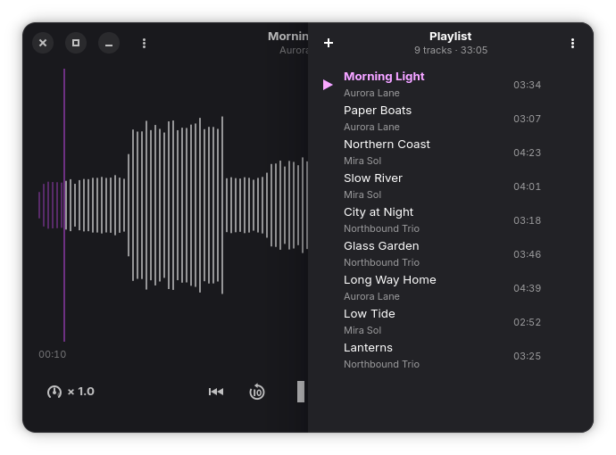

# Volna 🌊

A simple audio player for Linux that shows every track as a waveform.
Built with **Rust**, **GTK4**, **libadwaita** and **GStreamer**.

🌐 **Website:** [jic8.github.io/volna](https://jic8.github.io/volna/)



---

## Features

*   **Waveform view:** click anywhere on the waveform to seek; ±10 seconds from the keyboard.
*   **Playlists:** open individual files or whole folders, save and load M3U playlists.
*   **Playback speed:** 0.5× to 2× without changing the pitch.
*   **Session restore:** the playback queue is restored on the next launch.
*   **GNOME integration:** follows the system dark/light style.
*   **MPRIS:** control from system media widgets and hardware media keys.

---

## Installation

### Flatpak

```bash
flatpak install https://jic8.github.io/volna/volna.flatpakref
```

### Building from source

Requires GTK 4.14+, libadwaita 1.6+ and GStreamer 1.24+ with base/good plugins.

```bash
cargo run --release
```

### Local Flatpak build

```bash
flatpak run org.flatpak.Builder --user --install-deps-from=flathub \
  --force-clean --install build-dir build-aux/io.github.jic8.Volna.json

flatpak run io.github.jic8.Volna
```

*Note: after changing dependencies, regenerate `build-aux/cargo-sources.json` with
[flatpak-cargo-generator](https://github.com/flatpak/flatpak-builder-tools/tree/master/cargo).*

---

## Translations

Source strings are in English; translations live in `po/` and are managed with gettext.

To update the template and existing translations:

```bash
xgettext --language=Rust --from-code=UTF-8 --keyword=gettext --keyword=ngettext:1,2 \
  --files-from=po/POTFILES -o po/volna.pot

msgmerge --update po/ru.po po/volna.pot
```

To add a new language:

```bash
msginit -i po/volna.pot -l <lang_code>
```

Then append the language code to `po/LINGUAS`.

---

## Website

The project page lives in `docs/` and is published via GitHub Pages.

---

## License

GPL-3.0-or-later
